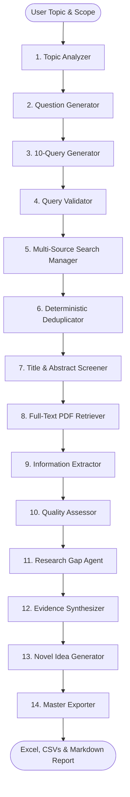

# Autonomous Academic Literature Intelligence & Systematic Discovery Agent

[](https://www.python.org/)
[](https://github.com/langchain-ai/langgraph)
[](https://ollama.com/)
[](LICENSE)
[](tests/)
[](#core-architectural-principles)

> An autonomous, reproducible research intelligence system engineered for systematic literature reviews, automated bibliographic discovery, evidence extraction, and literature-grounded research gap synthesis. Powered by **LangGraph** orchestration, local **Ollama (`qwen2.5:14b`)** inference, deterministic data processing, and open academic APIs.

**Authors**: **Md. Abu Johab** and **Md. Zohurul Islam**  
*Department of Computer Science and Engineering, Pabna University of Science and Technology (PUST)*

---

## Table of Contents

- [Abstract & Motivation](#abstract--motivation)
- [Core Architectural Principles](#core-architectural-principles)
- [End-to-End 14-Stage Pipeline Architecture](#end-to-end-14-stage-pipeline-architecture)
- [Multi-Database Academic Search Integration](#multi-database-academic-search-integration)
- [Methodological Quality Assessment Framework](#methodological-quality-assessment-framework)
- [Evidence-Grounded Research Gap & Novel Idea Generation](#evidence-grounded-research-gap--novel-idea-generation)
- [Interactive Literature Intelligence (Chat & DOI Q&A)](#interactive-literature-intelligence-chat--doi-qa)
- [Master Academic Artifacts & Exports](#master-academic-artifacts--exports)
- [Upcoming Database Integrations & Roadmap](#upcoming-database-integrations--roadmap)
- [Installation & Quick Start](#installation--quick-start)
- [Command-Line Interface (CLI) Manual](#command-line-interface-cli-manual)
- [Verification & Automated Test Suite](#verification--automated-test-suite)
- [Directory Structure](#directory-structure)
- [Academic Citation & Attribution](#academic-citation--attribution)

---

## Abstract & Motivation

Scientific literature in machine learning, remote sensing, and foundation models is expanding at an exponential rate, publishing thousands of papers every month. Traditional manual literature searches are:
1. **Prone to Selection Bias**: Researchers frequently sample only the highest-cited or top-venue papers, missing emerging preprints and cross-domain advances.
2. **Non-Reproducible**: Ad-hoc keyword querying lacks systematic audit trails, query validation, and screening logs.
3. **Labor-Intensive**: Extracting methodologies, model architectures, benchmark datasets, and reported limitations across hundreds of papers requires weeks of manual reading.
4. **Vulnerable to LLM Hallucinations**: Standard conversational LLMs invent non-existent citations, misattribute results, and cannot reliably verify DOIs or extract empirical figures from raw PDFs.

This system resolves these challenges by introducing a **hybrid neuro-symbolic framework**: local Large Language Models (**Qwen 2.5 14B**) serve exclusively as reasoning, extraction, and synthesis engines, while all searches, DOI resolutions, deduplications, citation verifications, full-text PDF parsing, and metric computations are executed by **100% deterministic Python tools and SQLite storage**.

---

## Core Architectural Principles

```
  ┌─────────────────────────────────────────────────────────────────────────────┐
  │                         AGENTIC REASONING LAYER                             │
  │  Ollama (Qwen 2.5 14B) - Zero Hallucination Prompting & Pydantic Validation  │
  └──────────────────────────────────────┬──────────────────────────────────────┘
                                         │ Structured JSON Function Calling
  ┌──────────────────────────────────────▼──────────────────────────────────────┐
  │                      DETERMINISTIC EXECUTION LAYER                          │
  │  Multi-Source Search  │  DOI Deduplication  │  PyMuPDF Parser  │  SQLite DB │
  └─────────────────────────────────────────────────────────────────────────────┘
```

1. **Deterministic Data Integrity**: Paper records, citation counts, published dates, and DOI links originate directly from official academic registries (OpenAlex, Crossref, arXiv, Semantic Scholar). The LLM is never permitted to invent metadata.
2. **Local & Confidential**: All inference runs locally via Ollama. No proprietary research hypotheses, draft methodologies, or private literature extracts leave your workstation.
3. **Evidence-Grounded Syntheses**: Every identified research gap must cite specific papers collected during the search or be marked as an unverified hypothesis.
4. **Resilience & Fault Tolerance**: Academic APIs that degrade or return rate limits (such as arXiv HTTP 429) automatically trigger graceful fallback routines without halting the LangGraph execution state.

---

## End-to-End 14-Stage Pipeline Architecture

The workflow is compiled as a stateful directed acyclic graph (**LangGraph `StateGraph`**) with checkpoints.



### Detailed Stage Breakdown

| Stage | Node Name | Methodological Function | Deterministic vs LLM |
| :--- | :--- | :--- | :--- |
| **1** | `Topic Analyzer` | Dissects topic scope, research dimensions, domain constraints, and inclusion priorities. | LLM reasoning |
| **2** | `Question Generator` | Generates 3–5 foundational research questions covering architectures, benchmarks, and applications. | LLM reasoning |
| **3** | `10-Query Generator` | Formulates exactly 10 multi-dimensional search queries with boolean keyword combinations. | LLM reasoning |
| **4** | `Query Validator` | Checks query syntax, specificity, and keyword yield balance; refines weak or overly broad queries. | LLM validation |
| **5** | `Multi-Source Search` | Concurrently queries OpenAlex, Crossref, arXiv, and Semantic Scholar; ingests up to 1,000 raw records. | Deterministic API |
| **6** | `Deduplicator` | Merges records by normalized DOI, arXiv ID, and fuzzy title similarity (token sort ratio > 0.88). | Deterministic Python |
| **7** | `Screening Agent` | Evaluates titles/abstracts against explicit criteria; classifies into *Include*, *Maybe*, or *Exclude*. | LLM + Heuristics |
| **8** | `PDF Retrieval` | Locates open-access PDF URLs and parses sections (Abstract, Methods, Results, Limitations) using PyMuPDF. | Deterministic Python |
| **9** | `Information Extraction` | Extracts model architectures, pretraining strategies, datasets, evaluation metrics, and findings. | LLM extraction |
| **10** | `Quality Assessment` | Evaluates studies on a 9-criterion methodological transparency, reproducibility, and rigor rubric. | LLM rubric scoring |
| **11** | `Research Gap Agent` | Synthesizes open methodological challenges, conflicting findings, and underexplored areas. | LLM + Citation Grounding |
| **12** | `Evidence Synthesis` | Formulates narrative trends, architecture taxonomy, dataset utilization tables, and benchmark comparisons. | LLM synthesis |
| **13** | `Novel Idea Generator` | Proposes 3–5 novel research ideas with feasible architectures, expected contributions, and validation protocols. | LLM reasoning |
| **14** | `Master Exporter` | Assembles 8-sheet formatted Excel workbook, 4 standard CSV files, and an academic Markdown synthesis report. | Deterministic Python |

---

## Multi-Database Academic Search Integration

The agent integrates with the world's most comprehensive open academic repositories without requiring commercial API keys:

```
  ┌─────────────────────────────────────────────────────────────────────────────┐
  │                           ACADEMIC DATA SOURCES                             │
  ├──────────────────┬──────────────────┬──────────────────┬────────────────────┤
  │     OpenAlex     │     Crossref     │      arXiv       │  Semantic Scholar  │
  │   250M+ Works    │  150M+ Metadata  │  2.4M+ Preprints │    215M+ Papers    │
  │ Global Coverage  │  Official DOIs   │ AI / CV / Remote │ Citation & Impact  │
  └──────────────────┴──────────────────┴──────────────────┴────────────────────┘
```

1. **OpenAlex**: Primary scholarly graph indexing 250M+ works with institutional affiliations, citation counts, open-access status, and conceptual hierarchies.
2. **Crossref**: The authoritative official DOI registration agency for commercial publishers (IEEE, Elsevier, Springer, Nature, Wiley).
3. **arXiv**: Real-time preprint coverage for artificial intelligence, computer vision, and machine learning publications.
4. **Semantic Scholar**: S2AG graph providing clean abstract text, influential citation counts, and semantic embeddings.
5. **Unpaywall**: Legitimate open-access full-text PDF resolution via publisher-hosted repositories and university archives.

---

## Methodological Quality Assessment Framework

Studies selected for full extraction are evaluated against a **9-Criterion Methodological Rigor Rubric** (each scored on a continuous scale from $0.0$ to $10.0$):

$$\text{Total Quality Score} = \frac{1}{9} \sum_{i=1}^{9} \text{Criterion}_i$$

1. **Clarity of Research Objectives**: Explicit problem definition, target hypothesis, and scope.
2. **Dataset Transparency**: Clear reporting of dataset origins, sensor modalities, train/val/test splits, and sample sizes.
3. **Methodological Clarity**: Detailed mathematical descriptions of loss functions, layers, and tokenization.
4. **Experimental Reproducibility**: Complete hyperparameters (batch size, learning rate, GPU specs, epochs, optimizers).
5. **Baseline Comparisons**: Rigorous comparison against standard state-of-the-art architectures under identical test splits.
6. **Metrics Appropriateness**: Use of domain-appropriate evaluation metrics (e.g., Overall Accuracy, Kappa, mIoU, RMSE, F1-Score).
7. **Statistical Validation**: Cross-validation, standard deviation over multiple random seeds, and significance testing.
8. **Limitations Discussion**: Transparent analysis of computational bottlenecks, failure cases, and domain shift vulnerability.
9. **Code & Data Availability**: Public repository links (GitHub, Zenodo, Hugging Face) and reproducible checkpoints.

---

## Evidence-Grounded Research Gap & Novel Idea Generation

Generic LLMs frequently propose generic research ideas that have already been published. To guarantee academic contribution, our **Research Gap Agent** enforces strict evidence grounding:

1. **Explicit Literature Citations**: Every proposed gap must reference specific papers retrieved during the search.
2. **Verification Status**: Gaps are classified as:
   - `Supported by Literature`: Explicitly mentioned as a limitation in the collected papers.
   - `Synthesized Pattern`: Identified by comparing conflicting findings or missing benchmarks across multiple studies.
   - `Unverified Hypothesis`: Emerging theoretical direction requiring experimental verification.
3. **Feasibility Scoring**: Proposed ideas are evaluated on technical feasibility ($0.0$ to $10.0$), novelty relative to prior art, and required computational resources.

---

## Interactive Literature Intelligence (Chat & DOI Q&A)

In addition to autonomous batch execution, the system features an **Interactive Literature Intelligence Mode**. Researchers can converse with the collected literature database in real time:

```text
ResearchAgent> what was the objective and architecture for the paper doi: 10.1109/tpami.2024.3362475
```

```text
=== QWEN 2.5 14B VERIFIED RESPONSE ===
Title: SpectralGPT: Spectral Remote Sensing Foundation Model
DOI: 10.1109/tpami.2024.3362475
Year: 2024 | Citations: 42

Research Objective:
The primary objective of SpectralGPT was to construct a universal foundation model
specifically designed for spectral remote sensing data, accommodating varying spatial
sizes, spectral resolutions, time series, and regions through progressive pretraining.

Model Architecture:
The paper introduces a novel 3D Generative Pretrained Transformer (3D-GPT) utilizing
3D spatial-spectral token generation to decouple spatial and spectral representations,
capturing sequential spectral patterns through multi-target masked autoencoding.
```

The system automatically extracts the requested DOI from natural language, fetches the structured extraction from SQLite, and injects the ground-truth evidence directly into Qwen's context window.

---

## Master Academic Artifacts & Exports

Every discovery run exports comprehensive academic artifacts into `hsi_research_agent/exports/`:

### 1. Master Excel Workbook (`HSI_Literature_Discovery.xlsx`)
A publication-ready, 8-sheet master workbook formatted with frozen header panes (`A2`), autofilters, clickable DOI hyperlinks, and auto-adjusted column widths:
- **Sheet 1: `Topic & Scope`**: Formal scope definition, domain constraints, inclusion/exclusion criteria.
- **Sheet 2: `Search Strategy`**: All 10 generated queries, research dimensions, keywords, and validation metrics.
- **Sheet 3: `Canonical Literature`**: Complete deduplicated literature catalog with authors, venues, years, DOIs, and citation counts.
- **Sheet 4: `Screening Decisions`**: Documented inclusion/exclusion decisions with formal methodological justifications.
- **Sheet 5: `Extracted Evidence`**: Granular breakdown of architectures, datasets, loss functions, metrics, and limitations.
- **Sheet 6: `Quality Assessment`**: 9-criterion rubric scores, composite transparency indices, and reviewer justifications.
- **Sheet 7: `Research Gaps`**: Categorized evidence-grounded research gaps linked to primary study citations.
- **Sheet 8: `Novel Research Ideas`**: Ranked research proposals with architectural specifications and validation plans.

### 2. Standard CSV Files
- `papers.csv`: All canonical papers with abstracts, DOIs, URLs, and citation statistics.
- `queries.csv`: Search queries, keywords, and validation ratings.
- `gaps.csv`: Research gaps, evidence snippets, and confidence ratings.
- `ideas.csv`: Novel research ideas, feasibility scores, and model designs.

### 3. Academic Markdown Report (`research_report_*.md`)
A formatted academic synthesis document complete with executive summary, methodology breakdown, dataset utilization analysis, architectural trends, and full bibliographic citations.

---

## Upcoming Database Integrations & Roadmap

While the system currently integrates natively with **OpenAlex**, **Crossref**, **arXiv**, **Semantic Scholar**, and **Unpaywall** with zero mandatory API keys, expanded coverage through additional institutional and commercial academic database APIs is scheduled for upcoming releases:

- **IEEE Xplore Native REST API**: Direct authenticated queries for IEEE transactions, journals, and conference proceedings with granular IEEE subject term filters.
- **PubMed / NCBI Entrez API**: Biomedical, clinical literature, radiology, and healthcare machine learning indexing with MeSH (Medical Subject Headings) query mapping.
- **Elsevier Scopus & ScienceDirect APIs**: Comprehensive citation indexing and subscription-tier full-text access for Elsevier journals via institutional API keys.
- **Clarivate Web of Science (WoS) Starter API**: Journal citation reports, core collection indexing, and impact factor filtering.
- **Google Scholar Programmatic Serp Integration**: Controlled, rate-compliant scholarly indexing to retrieve grey literature and emerging workshop preprints.
- **ACM Digital Library**: Association for Computing Machinery conference proceedings and computing surveys.

---

## Installation & Quick Start

### 1. Prerequisites
- **Python**: Version 3.10 or higher.
- **Ollama**: Download and install from [ollama.com](https://ollama.com/).
- **Model**: Pull the recommended local reasoning model:
  ```bash
  ollama pull qwen2.5:14b
  ```

### 2. Clone & Setup Environment
```bash
git clone https://github.com/Abu-Johab/Paper_Searching_Agent_Project.git
cd Paper_Searching_Agent_Project

# Create and activate a virtual environment
python -m venv .venv
.\.venv\Scripts\Activate.ps1    # On Windows PowerShell
# source .venv/bin/activate       # On Linux / macOS

# Install core dependencies
pip install -r requirements.txt
```

### 3. Environment Configuration
Verify your `.env` configuration file in the project root:
```ini
OLLAMA_BASE_URL=http://localhost:11434
OLLAMA_MODEL=qwen2.5:14b
CONTACT_EMAIL=researcher@university.edu
```

---

## Command-Line Interface (CLI) Manual

### Option A: Guided Interactive Setup Wizard (Recommended)
Simply launch without arguments:
```powershell
python main.py
```
The wizard will guide you through mode selection, topic formulation, year bounds, and database selection, then automatically launch the search and open the interactive chat session:

```text
================================================================================
                 RESEARCH AGENT INTERACTIVE SETUP
================================================================================
How would you like to start?
  [1] Search academic literature & enter chat (Recommended)
  [2] Chat with already collected papers (Q&A by DOI / Topic)
  [3] Search & Export only (no chat)

Select an option [1-3, default 1]: 1

--- Search Parameters ---
1. Enter research topic: Hyperspectral Foundation Models in Agriculture
2. Enter start year [default 2020]: 2022
3. Enter end year [default 2026]: 2026
4. Enter databases [openalex, crossref, arxiv] (press Enter for fast openalex,crossref): 
```

### Option B: Direct Batch Execution with Year Constraints
Run fully autonomously with specific parameters:
```powershell
python main.py --topic "Hyperspectral Foundation Models in Agriculture" --start-year 2022 --end-year 2026
```

### Option C: High-Speed Search (OpenAlex + Crossref)
Bypass preprint server rate limits during peak hours:
```powershell
python main.py --topic "SpectralGPT for Remote Sensing" --sources openalex,crossref
```

### Option D: Direct Interactive Chat
Jump directly into conversational Q&A with your collected literature database:
```powershell
python main.py --chat
```

---

## Verification & Automated Test Suite

The system includes a 35-test unit and integration test suite covering all 14 pipeline stages:

```powershell
pytest -q
```

```text
...................................                                      [100%]
35 passed in 5.37s
```

### Test Coverage Highlights:
- `test_phase1.py`: Topic analyzer, domain inference, and research question generation.
- `test_queries.py`: 10-query assembly, dimension coverage, and Pydantic schema validation.
- `test_search.py`: Query dispatch, API timeout handling, and graceful rate-limit fallbacks.
- `test_deduplication.py`: Exact DOI normalization, title sanitization, and fuzzy string distance matching.
- `test_screening.py`: Pydantic structured output parsing, scoring thresholds, and exclusion logs.
- `test_research_intelligence.py`: Evidence citation checking, gap validation, and idea feasibility scoring.
- `test_export.py`: Excel sheet creation, formula integrity, table formatting, and CSV data dumping.
- `test_workflow.py`: End-to-end LangGraph state transition and checkpoint verification.

---

## Directory Structure

```text
Paper_Searching_agent/
├── main.py                     # Primary user entry point & interactive wizard
├── requirements.txt            # Python package dependencies
├── pyproject.toml              # Build system & package metadata
├── README.md                   # Comprehensive academic documentation
├── .env / .env.example         # Local environment & Ollama configuration
├── tests/                      # Automated test suite (35 passing tests)
│   ├── test_phase1.py          # Topic & Question generation tests
│   ├── test_queries.py         # Search query generation & validation tests
│   ├── test_search.py          # Multi-source search manager tests
│   ├── test_deduplication.py   # DOI & Title deduplication tests
│   ├── test_screening.py       # Title/Abstract screening tests
│   ├── test_research_intelligence.py # Gap & Novel idea tests
│   ├── test_export.py          # Excel & CSV export tests
│   └── test_workflow.py        # Full LangGraph integration tests
└── hsi_research_agent/         # Core research intelligence package
    ├── config.py               # Pydantic settings & path management
    ├── main.py                 # Module CLI & conversational chat loop
    ├── agents/                 # Specialized LLM reasoning agents
    │   ├── topic_analyzer.py   # Research scope & boundary analysis
    │   ├── question_generator.py # Research question formulation
    │   ├── query_generator.py  # 10 multi-dimensional query generation
    │   ├── query_validator.py  # Query quality & specificity validation
    │   ├── screening_agent.py  # Heuristic & LLM paper screening
    │   ├── extraction_agent.py # Deep methodology & dataset extraction
    │   ├── quality_agent.py    # 9-criterion methodological quality scoring
    │   ├── research_gap_agent.py # Evidence-grounded research gap synthesis
    │   ├── idea_generator.py   # Feasible novel research idea generation
    │   └── synthesis_agent.py  # Trend analysis & evidence synthesis
    ├── graph/                  # LangGraph workflow orchestration
    │   ├── state.py            # TypedDict workflow state definitions
    │   ├── nodes.py            # Graph node execution handlers
    │   └── workflow.py         # StateGraph compilation & checkpointing
    ├── search/                 # Academic database API clients
    │   ├── openalex.py         # OpenAlex REST client
    │   ├── crossref.py         # Crossref DOI client
    │   ├── arxiv.py            # arXiv preprint client
    │   ├── semantic_scholar.py # Semantic Scholar API client
    │   ├── unpaywall.py        # Unpaywall open-access PDF resolver
    │   └── search_manager.py   # Multi-source orchestrator & dispatcher
    ├── processing/             # Deterministic data processing
    │   ├── deduplicator.py     # Multi-pass deduplication algorithm
    │   ├── normalizer.py       # Text sanitization & DOI canonicalization
    │   ├── pdf_processor.py    # PyMuPDF full-text downloader & parser
    │   └── relevance_scorer.py # Heuristic relevance pre-ranking
    ├── llm/                    # Local LLM integration layer
    │   ├── client.py           # Ollama client with retry & JSON repair
    │   └── prompts.py          # Structured prompt loader
    ├── storage/                # Persistent data layer
    │   ├── database.py         # SQLite schema initialization
    │   ├── models.py           # Pydantic data schemas
    │   └── repository.py       # Thread-safe repository access methods
    ├── prompts/                # Academic prompt templates (.txt)
    │   ├── topic_analysis.txt
    │   ├── question_generation.txt
    │   ├── query_generation.txt
    │   ├── query_validation.txt
    │   ├── research_gap.txt
    │   ├── idea_generation.txt
    │   └── synthesis.txt
    ├── exports/                # Generated research deliverables
    │   ├── HSI_Literature_Discovery.xlsx  # 8-Sheet Master Excel Workbook
    │   ├── papers.csv          # Catalog of unique canonical studies
    │   ├── queries.csv         # 10 validated search queries
    │   ├── gaps.csv            # Formulated research gaps
    │   ├── ideas.csv           # Novel research ideas
    │   └── research_report_*.md # Academic synthesis report
    └── data/                   # SQLite database storage
        └── research_agent.db   # Canonical study records & extraction cache
```

---

## Academic Citation & Attribution

If you utilize this agent, its methodology, or architecture in your thesis, research, or publication, please cite it as follows:

```bibtex
@misc{johab2026researchagent,
  author       = {Md. Abu Johab and Md. Zohurul Islam},
  title        = {Autonomous Academic Research Discovery and Systematic Literature Intelligence Agent},
  institution  = {Department of Computer Science and Engineering, Pabna University of Science and Technology},
  year         = {2026},
  publisher    = {GitHub},
  version      = {2.0.0},
  howpublished = {\url{https://github.com/Abu-Johab/Paper_Searching_Agent_Project}}
}
```

**Authors**:
- **Md. Abu Johab** — *Dept. of Computer Science and Engineering, Pabna University of Science and Technology*
- **Md. Zohurul Islam** — *Dept. of Computer Science and Engineering, Pabna University of Science and Technology*

---

## License

This project is licensed under the **MIT License** — see the [LICENSE](LICENSE) file for full details. Academic and commercial reuse is permitted with attribution.
